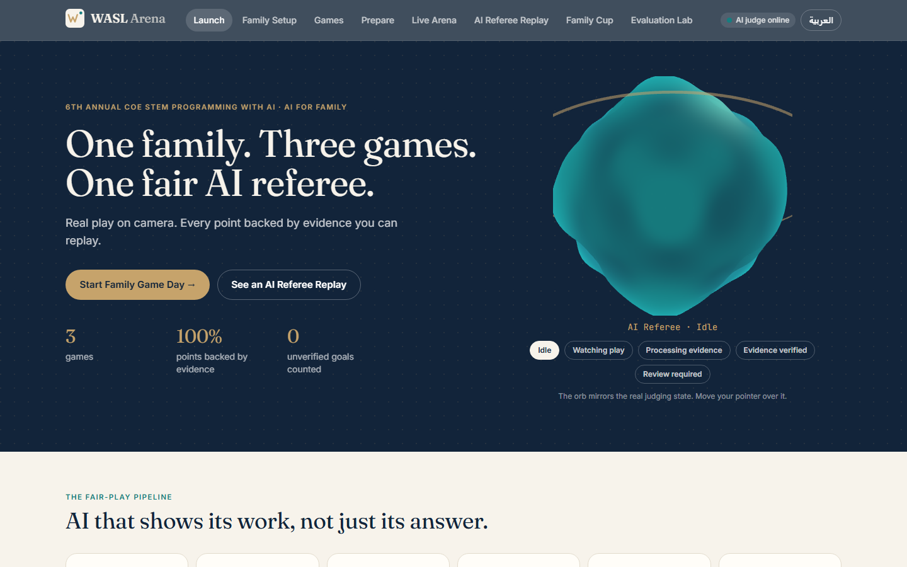

<h1 align="center">WASL Arena</h1>

<h3 align="center">One family. Three games. One fair AI referee.</h3>

<b>6th Annual COE STEM Programming with AI Competition &middot; Abu Dhabi University &middot; Theme: AI for Family</b>

  
  
  

  
  
  
  

  

<i>The deployed website (launch screen). <a href="https://maymourad.github.io/wasl-arena">Open the live app &rarr;</a></i>

<h2 align="center">Watch the full prototype working</h2>

  

<i>A recording of the real, deployed site: launch, family setup, game library, a live upload judged by the production AI backend, the AI Referee Replay with host review, the Family Cup and the Evaluation Lab. <a href="https://github.com/MayMourad/wasl-arena/blob/main/docs/tour/website-tour.mp4">Watch the full video (about 4 min) &rarr;</a></i>

<h2>Try the prototype (60 seconds)</h2>

<table>
  <tr><th align="left">Step</th><th align="left">Where</th><th align="left">What you will see</th></tr>
  <tr><td>1</td><td><a href="https://maymourad.github.io/wasl-arena"><b>Open the app</b></a></td><td>The AI-Referee orb reacts to its state (Idle, Watching, Processing, Verified, Review). The header badge shows <b>AI judge online</b>.</td></tr>
  <tr><td>2</td><td><a href="https://maymourad.github.io/wasl-arena/replay?report=sample-football_goal">Football replay</a></td><td>A judged clip: video with tracking overlay, evidence frames, the rule applied, score change, verification status and integrity hashes.</td></tr>
  <tr><td>3</td><td><a href="https://maymourad.github.io/wasl-arena/replay?report=sample-falaj_valid">Falaj Flow replay</a></td><td>Split screen: the physical board and the digital twin rebuilt by the AI, water tracing the validated route.</td></tr>
  <tr><td>4</td><td><a href="https://maymourad.github.io/wasl-arena/replay?report=sample-souq_correct_gemini">Souq Signal replay</a></td><td>Cards recognised, speech transcribed (Arabic/English), verified basket and budget.</td></tr>
  <tr><td>5</td><td><b>Live Arena &rarr; Upload video &rarr; Send to AI Referee</b></td><td>Your own clip is judged by the live backend through five real stages, then opens in Replay.</td></tr>
  <tr><td>6</td><td><a href="https://maymourad.github.io/wasl-arena/lab">Evaluation Lab</a></td><td>The tests that actually ran, expected vs actual, and an honest synthetic-vs-real note.</td></tr>
</table>

<i>The free-tier AI judge sleeps when idle: the first live upload after a break can take about 30 s. The sample replays work instantly.</i>

<b>Links:</b>
<a href="https://maymourad.github.io/wasl-arena">App (GitHub Pages)</a> &middot;
<a href="https://frontend-three-fawn-47.vercel.app">App (Vercel mirror)</a> &middot;
<a href="https://wasl-arena.onrender.com/api/health">AI judge health</a> &middot;
<a href="https://github.com/MayMourad/wasl-arena/blob/main/docs/tour/website-tour.mp4">Walkthrough video</a> &middot;
<a href="https://github.com/MayMourad/wasl-arena/releases/download/v1.0-submission/WASL-Arena-Technical-Report.pdf">Technical report (PDF)</a> &middot;
<a href="https://github.com/MayMourad/wasl-arena/releases/tag/v1.0-submission">All release downloads</a> &middot;
<a href="https://github.com/MayMourad/wasl-arena/blob/main/docs/REAL_FOOTAGE.md">Recording guide</a>

<h2>The team</h2>

<table>
  <tr><th align="left">Team</th><th align="left">Team code</th><th align="left">Track</th></tr>
  <tr><td><b>204</b></td><td><b>AYUCK</b></td><td><b>Cycle 3: grades 9-12</b></td></tr>
</table>

May Ahmed Mourad (G12) &middot; Shamsa Faris Almazrouei (G12) &middot; Fatima Mohamed Almazrouei (G11)

<h2>What it is</h2>

WASL Arena is a working web app where a family plays three games while an AI referee watches the video, listens to the audio, applies written rules and keeps score. Every score is backed by <b>replayable evidence</b> (source video, timestamps, annotated frames, rule applied, status). If the AI cannot see it, the call is <code>NEEDS_REVIEW</code> and the human host decides.

<table>
  <tr><th align="left">Game</th><th align="left">Mode</th><th align="left">What the AI does</th></tr>
  <tr><td><b>Football AI</b></td><td>Team</td><td>Tracks ball and players, detects goals in calibrated zones, measures possession, MVP = longest possession</td></tr>
  <tr><td><b>Falaj Flow</b></td><td>Team</td><td>Reads a printed 5x5 board and tiles (ArUco markers), rebuilds the channel network as a graph, traces water to three farms</td></tr>
  <tr><td><b>Souq Signal</b></td><td>Individual</td><td>Recognises product cards, transcribes Arabic/English speech, checks audio and video agree, does budget maths</td></tr>
</table>

<h2>The full website, screen by screen</h2>

Full-page captures of the deployed site, recorded in a real browser session (click any image for full size).

<table>
<tr>
<td width="50%" valign="top"> <b>1 &middot; Launch</b>: interactive AI-Referee orb, pipeline, games, team</td>
<td width="50%" valign="top"> <b>2 &middot; Family Setup</b>: players, teams, language, match rules</td>
</tr>
<tr>
<td valign="top"> <b>3 &middot; Game Library</b>: exactly three games, team and individual</td>
<td valign="top"> <b>4 &middot; Game Preparation</b>: rules, goal calibration, equipment, printables</td>
</tr>
<tr>
<td valign="top"> <b>5 &middot; Live Arena</b>: camera/mic or upload, timer, turns, scoreboard</td>
<td valign="top"> <b>5b &middot; Live judging</b>: real stages from the production AI judge</td>
</tr>
<tr>
<td valign="top"> <b>6 &middot; AI Referee Replay</b>: a NEEDS_REVIEW call, evidence, rule, accept/reject</td>
<td valign="top"> <b>6b &middot; Falaj replay</b>: physical board and digital twin, water on validated edges</td>
</tr>
<tr>
<td valign="top"> <b>6c &middot; Souq replay</b>: card recognition, transcript, verified basket</td>
<td valign="top"> <b>7 &middot; Family Cup</b>: results with reasons, MVP, standings</td>
</tr>
<tr>
<td colspan="2" valign="top"> <b>8 &middot; Evaluation Lab</b>: tests that actually ran, expected vs actual, limitations</td>
</tr>
</table>

<i>The Cup and live-judging captures come from a scripted tour that uploads a clearly named <b>synthetic test clip</b>. They demonstrate the product flow, not real family gameplay.</i>

<b>Responsive:</b> the same site on a phone.

  
  
  

<h2>How the AI judges (and shows its work)</h2>

<table>
<tr>
<td width="50%" valign="top"> Football: evidence frame (ball trail, player tracks, goal zone), from a synthetic fixture</td>
<td width="50%" valign="top"> Falaj: board read from video, tiles recognised, water path in teal (synthetic fixture)</td>
</tr>
</table>

<h2>Repository layout</h2>

<pre>
frontend/      React + TypeScript + Vite + Tailwind (+ Three.js orb)  -> Vercel
backend/       FastAPI judge: app/rules (deterministic), app/vision (OpenCV/FFmpeg), tests/  -> Render
tools/         fixtures, printables, sample export, screenshots, tour recorder, converters
fixtures/      SYNTHETIC test clips + manifest (ground truth)   [mp4s git-ignored; regenerate]
docs/          technical report (.docx + .pdf), figures, screenshots, full-page captures, website tour
presentation/  30-slide deck (.pptx + .pdf) + generator
video/         120 s production package, final script PDF, draft animatic
ai-usage/      AI chat usage report + original conversation exports (redacted)
</pre>

Printable boards, tiles and cards: <code>frontend/public/printables/</code> (also linked from the Prepare screen).

<h2>Run locally</h2>

<pre>
# backend (Python 3.11+)
cd backend &amp;&amp; python -m venv .venv &amp;&amp; .venv/Scripts/activate   # Linux/macOS: source .venv/bin/activate
pip install -r requirements.txt
cp .env.example .env          # add GEMINI_API_KEY (speech transcription only) and a JUDGE_SIGNING_KEY
uvicorn app.main:app --port 8000

# frontend
cd frontend &amp;&amp; npm install &amp;&amp; npm run dev      # Vite proxies /api to :8000
</pre>

<h2>Tests (all actually run)</h2>

<pre>
cd backend
python ../tools/make_fixtures.py     # synthetic fixtures with known ground truth
pytest                               # 46 tests: rules, CV pipelines, integrity, API, audit chain
python ../tools/export_samples.py    # regenerates frontend/public/samples + evaluation.json
</pre>

Last run: <b>46/46 passed</b>; 9/9 synthetic fixtures match ground truth. The fixtures are <b>synthetic renders, not real gameplay</b>; no real family footage has been analysed yet and no accuracy percentage is claimed.

<h2>Stand-alone AI judge (hash-verified)</h2>

<pre>python -m app.judge_cli football match.mp4 -o report.json     # also: falaj, souq</pre>

Import <code>report.json</code> in Live Arena &rarr; "Import AI report". The app verifies SHA-256 + HMAC and rejects edited reports.

<h2>Deploy</h2>

<ul>
  <li><b>Frontend &rarr; Vercel:</b> Root Directory <code>frontend</code>, env <code>VITE_API_URL=https://&lt;render-service&gt;.onrender.com</code>.</li>
  <li><b>Backend &rarr; Render:</b> root dir <code>backend</code> (<code>render.yaml</code>). Set <code>GEMINI_API_KEY</code>, <code>JUDGE_SIGNING_KEY</code>, <code>CORS_ORIGINS=https://&lt;vercel-app&gt;.vercel.app</code>.</li>
  <li>Credentials live only in server environment variables. <code>.env</code> is git-ignored.</li>
</ul>

<b>Live deployment (verified):</b> app <a href="https://maymourad.github.io/wasl-arena">maymourad.github.io/wasl-arena</a> (GitHub Pages) and <a href="https://frontend-three-fawn-47.vercel.app">frontend-three-fawn-47.vercel.app</a> (Vercel) &middot; AI judge <a href="https://wasl-arena.onrender.com/api/health">wasl-arena.onrender.com</a>. All routes return 200, the header badge shows "AI judge online", a Falaj fixture judged on the live backend scored 11 with a valid integrity seal, CORS is restricted to the Vercel origin. Free-tier hosting sleeps when idle and does not persist uploads.

<h2>Honest limitations</h2>

Controlled setup (fixed camera, single-colour ball, contrasting shirts, calibrated goals); colour segmentation is lighting-sensitive; shirt numbers are not read (host assigns tracks to players); printed markers can be hidden; speech timing is approximate (about 1 s); detection scores are heuristics, not calibrated probabilities.

<h2>AI assistance</h2>

Built with ChatGPT (concept) and Claude Code / Claude Sonnet 5.5 (implementation); Gemini used at runtime for transcription only. See <a href="ai-usage/"><code>ai-usage/</code></a>.

